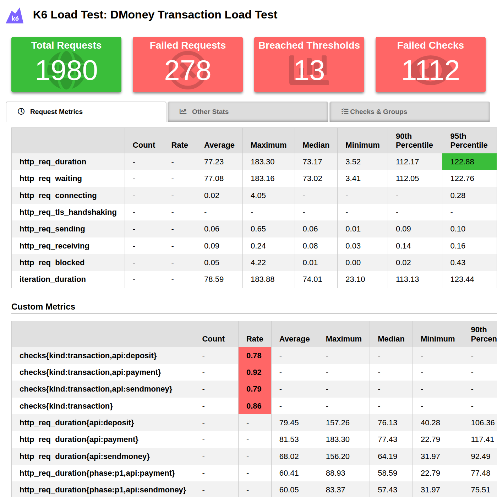
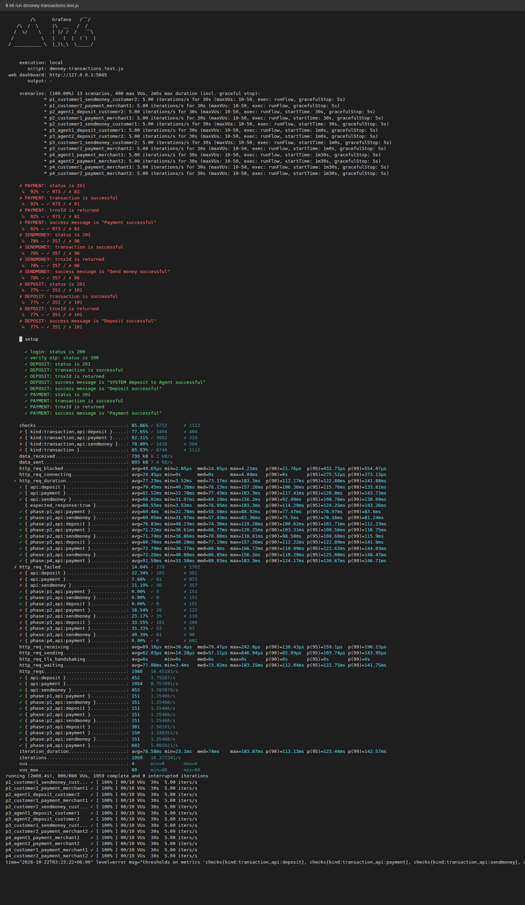
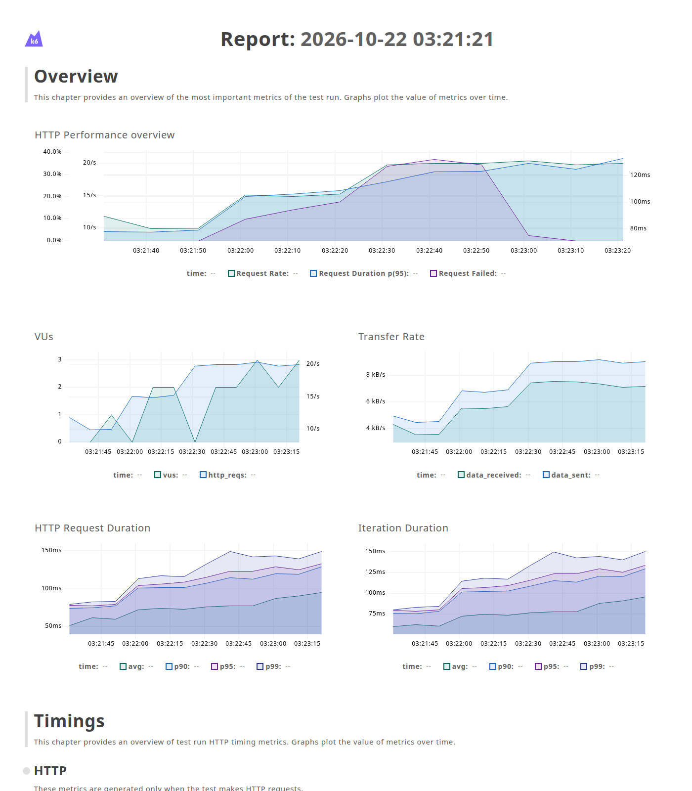

# DMoney Transaction Load Test (k6)

A k6 performance test for the DMoney transaction API. It replays a 2-minute workload of deposits, send-money transfers and merchant payments between six users. It then compares how the three transaction APIs behave as the workload changes.

- **Test script:** [dmoney-transactions.test.js](dmoney-transactions.test.js)
- **HTML report:** [reports/report.html](reports/report.html) (k6-reporter), plus [reports/dashboard.html](reports/dashboard.html) (k6 web dashboard with time-series graphs)
- **API comparison:** [reports/api-comparison.md](reports/api-comparison.md), generated automatically after every run

---

## Scenario

Six users: **Agent 1, Agent 2, Customer 1, Customer 2, Merchant 1, Merchant 2**. Every user logs in with their own credentials.

| Time | Flows running concurrently | APIs used |
|---|---|---|
| **0–30 s** (P1) | Customer 1 → Customer 2 send money<br>Customer 2 → Merchant 1 payment | sendmoney, payment |
| **30–60 s** (P2) | Customer 2 → Customer 1 send money<br>Agent 1 → Customer 2 deposit<br>Customer 1 → Merchant 1 payment | sendmoney, deposit, payment |
| **60–90 s** (P3) | Agent 1 → Customer 1 deposit<br>Agent 2 → Customer 2 deposit<br>Customer 1 → Customer 2 send money<br>Customer 2 → Merchant 2 payment | deposit ×2, sendmoney, payment |
| **90–120 s** (P4) | Agent 1 → Merchant 1 payment<br>Agent 2 → Merchant 2 payment<br>Customer 1 → Merchant 1 payment<br>Customer 2 → Merchant 2 payment | payment ×4 |

### How it is modelled

- Each flow is its own k6 **scenario** using the `constant-arrival-rate` executor. A flow sends **5 transactions/s** (configurable with `RATE`) for 30 s, and its `startTime` places it in its phase. All flows in a phase start together and run for the whole window.
- With an arrival-rate executor, the request rate stays fixed even if the server slows down. Any latency change between phases therefore comes from the server.
- Total load is **10 tx/s** in P1, **15 tx/s** in P2, and **20 tx/s** in P3 and P4.
- Every request is tagged with `api` (`deposit` / `sendmoney` / `payment`) and `phase` (`p1`–`p4`). These tags drive the per-API thresholds and the per-phase comparison.

### Authentication

`setup()` logs every user in with their own phone number and password:

1. `POST /user/login`
2. `POST /user/verify-otp?env=dev` with the backend's dev OTP (`0000`), which returns the JWT

Each flow then sends its requests with the token of the user who owns the `from_account`. The backend rejects a transaction whose token does not belong to the sender.

### Test data reset

The backend enforces balance checks and a 10,000 tk customer balance cap on deposits. Before every run, `setup()` resets the accounts to the same state:

| Account | Opening balance | Funded by |
|---|---|---|
| Agent 1, Agent 2 | 30,000 tk | SYSTEM → Agent deposit |
| Customer 1 | 7,000 tk | Agent 1 → Customer deposit (or a payment if above target) |
| Customer 2 | 5,000 tk | Agent 1 → Customer deposit (or a payment if above target) |

These balances are sized for `RATE=5`, so no account runs dry and no customer hits the deposit cap during the run. The test is therefore repeatable. Setup traffic is tagged `api:setup` and is left out of the per-API results.

---

## Assertions (checks)

Every transaction response is checked for:

| Check | Rule |
|---|---|
| Expected HTTP status code | `status === 201` |
| Transaction request is successful | message contains "successful" (and status 201) |
| Transaction ID is returned | `trnxId` is a non-empty string |
| Expected success message | exact match: `Deposit successful` / `Send money successful` / `Payment successful` |

The backend returns **208** for business errors such as insufficient balance. k6 does not count 208 as a failed request, so the status and message checks are what catch those cases.

## Thresholds

| Scope | Threshold |
|---|---|
| All requests | `http_req_failed` rate < 1% |
| All requests | `http_req_duration` p(95) < 1000 ms |
| All transactions | `checks{kind:transaction}` rate > 99% |
| **Deposit** | `http_req_duration{api:deposit}` p(95) < 1000 ms, p(99) < 1500 ms; `http_req_failed{api:deposit}` < 1%; `checks{kind:transaction,api:deposit}` > 99% |
| **Send Money** | same three rules on `api:sendmoney` |
| **Payment** | same three rules on `api:payment` |
| Per phase × API | p(95) < 1000 ms and failed < 1% (for example `http_req_duration{phase:p3,api:deposit}`), used to spot degradation |

---

## Project structure

```
.
├── dmoney-transactions.test.js   # main k6 test (scenarios, thresholds, setup, reporting)
├── lib/api.js                    # login, transaction requests, checks
├── scripts/create-users.mjs      # creates + activates the 6 test users via the admin API
├── data/users.example.json       # shape of data/users.json (the real file is git-ignored)
├── run-test.sh                   # runs the test and exports all reports
├── reports/                      # report.html, dashboard.html, summary.json/txt, api-comparison.md
└── screenshots/                  # screenshots used in this README
```

`exp1.js`, `grouping.js`, `html_report.js`, `post.js` and `scenario.js` are earlier k6 practice scripts and are not part of this test.

## How to run

**Prerequisites:** [k6](https://grafana.com/docs/k6/latest/set-up/install-k6/) (tested with v2.3.0), Node.js 18+, and the DMoney backend running (default `http://localhost:5000`).

```bash
# 1. Create the 6 test users (once per environment). Users get random names, phone
#    numbers and NIDs, a +alias Gmail address, password 1234, and are activated.
node scripts/create-users.mjs

# 2. Run the 2-minute test (writes everything into ./reports)
./run-test.sh
```

Optional environment variables:

| Variable | Default | Purpose |
|---|---|---|
| `BASE_URL` | `http://localhost:5000` | backend URL |
| `RATE` | `5` | transactions per second for each flow |
| `PHASE_SECONDS` | `30` | length of each phase (use 5 for a quick smoke run) |
| `SYSTEM_LOGIN` / `SYSTEM_PASSWORD` | `system@dmoney.com` / `1234` | SYSTEM account that funds the agents |
| `PARTNER_KEY` | `ROADTOSDET` | `X-AUTH-SECRET-KEY` header value |
| `DEBUG` | – | set to `1` to log the body of every failed transaction |

Example: `PHASE_SECONDS=5 RATE=2 ./run-test.sh` runs a quick smoke test.

> Note: each login of an Agent, Customer or Merchant makes the backend email an OTP to that user's Gmail address. The test logs in once per user per run.

---

## Results

Run on 2026-10-22 against a local backend (Node/Express + MySQL), at `RATE=5`, for 2 minutes. 1,980 requests were sent and k6 dropped no iterations.

### Screenshots

**HTML report (k6-reporter)** – [reports/report.html](reports/report.html)



**Terminal metrics (end-of-test summary)**



**k6 web dashboard (time series)** – [reports/dashboard.html](reports/dashboard.html)



### API comparison (overall)

Throughput is measured over the time each API was actually active.

| API | Active time | Requests | Throughput | Avg | Median | p90 | p95 | p99 | Max | Failed | Checks passed |
|---|---:|---:|---:|---:|---:|---:|---:|---:|---:|---:|---:|
| Deposit | 60 s | 452 | 7.53 req/s | 79.45 ms | 76.13 ms | 106.36 ms | 115.77 ms | 133.61 ms | 157.26 ms | **22.35%** | 77.65% |
| Send Money | 90 s | 453 | 5.03 req/s | 68.02 ms | 64.19 ms | 92.49 ms | 108.76 ms | 130.10 ms | 156.20 ms | **21.19%** | 78.81% |
| Payment | 120 s | 1054 | 8.78 req/s | 81.53 ms | 77.43 ms | 117.41 ms | 126.81 ms | 143.73 ms | 183.30 ms | **7.69%** | 92.31% |

### Per phase

| Phase | Total load | API | Requests | Avg | p95 | p99 | Failed |
|---|---:|---|---:|---:|---:|---:|---:|
| P1 (0–30 s) | 10 tx/s | sendmoney | 151 | 60.05 ms | 78.16 ms | 81.25 ms | 0.00% |
| P1 (0–30 s) | 10 tx/s | payment | 151 | 60.41 ms | 78.97 ms | 83.60 ms | 0.00% |
| P2 (30–60 s) | 15 tx/s | sendmoney | 151 | 71.74 ms | 108.69 ms | 115.90 ms | **23.18%** |
| P2 (30–60 s) | 15 tx/s | deposit | 151 | 76.83 ms | 102.71 ms | 112.23 ms | 0.00% |
| P2 (30–60 s) | 15 tx/s | payment | 151 | 71.23 ms | 109.56 ms | 116.75 ms | **18.54%** |
| P3 (60–90 s) | 20 tx/s | deposit | 301 | 80.76 ms | 122.89 ms | 141.80 ms | **33.55%** |
| P3 (60–90 s) | 20 tx/s | sendmoney | 151 | 72.26 ms | 125.08 ms | 148.48 ms | **40.40%** |
| P3 (60–90 s) | 20 tx/s | payment | 150 | 72.79 ms | 122.62 ms | 144.04 ms | **35.33%** |
| P4 (90–120 s) | 20 tx/s | payment | 602 | 91.59 ms | 130.68 ms | 146.72 ms | 0.00% |

### Threshold outcome

| Threshold | Result |
|---|---|
| p(95) < 1000 ms (global, per API, per phase) | ✅ passed everywhere (worst p95 was 130.68 ms) |
| p(99) < 1500 ms per API | ✅ passed |
| Failed requests < 1% | ❌ 14.04% overall (deposit 22.34%, send money 21.19%, payment 7.68%) |
| Transaction checks > 99% | ❌ 85.83% overall (deposit 77.65%, send money 78.80%, payment 92.31%) |

k6 exits with code 99 because the failure-rate and check thresholds were crossed.

### Analysis

**Response time.** All three APIs stayed fast: p95 was between 78 and 131 ms, roughly 8× below the 1 s target. Latency grew steadily with the workload. Payment p95 went from 79 ms (P1) to 110 ms (P2), 123 ms (P3) and 131 ms (P4), and its average rose about 50% (60 → 92 ms) when the load doubled from 10 to 20 tx/s. Send money had the lowest average latency (68 ms). Deposit (79 ms) and payment (82 ms) were slower. A deposit locks two accounts (agent and customer), and most payments ran in the busiest phase.

**Throughput.** The server kept up with the requested arrival rate in every phase: 151 requests per flow per 30 s, no dropped iterations, and never more than 4 VUs in flight. Throughput was not the bottleneck.

**Failures and degradation.** The real problem is errors. P1 and P4 had **0%** failures. P2 and P3, where deposits run alongside customer-to-customer transfers, failed **18–40%** of transactions. P4 had the highest request rate (20 tx/s, all payments) and still had no errors. So the failures come from contention between different transaction types on the same accounts, not from request volume. The k6 web dashboard shows the failure rate rising at 30 s, peaking in P3 and dropping back to zero at 90 s.

**Root cause.** Every failed request was an HTTP 500 with `"Deadlock found when trying to get lock; try restarting transaction"` (collected with `DEBUG=1`). All three controllers check the balance with:

```sql
SELECT COALESCE(SUM(credit) - SUM(debit), 0) FROM Transactions WHERE account = ? FOR UPDATE
```

The `Transactions` table has **no index on `account`** (only the primary key). So this locking read walks the whole primary index, and it has to wait on rows held by other in-flight transactions. MySQL's `SHOW ENGINE INNODB STATUS` confirmed it: two transactions running this balance lock for Customer 1 each held a `PRIMARY` record lock the other was waiting for, and InnoDB rolled one back. A deposit takes two of these locks (agent, then customer), so it collides with transfers on the same customer. The table also grows by 2–3 rows per transaction, so each scan gets slower over time, which adds to the latency growth.

**Recommendations for the backend**

1. Add an index: `CREATE INDEX idx_transactions_account ON Transactions(account);`. The locking read then touches only that account's rows.
2. Lock the accounts in a consistent order (for example sorted by phone number), or lock one balance row per account instead of summing the ledger.
3. Retry on `ER_LOCK_DEADLOCK` on the server side instead of returning 500 to the client.
